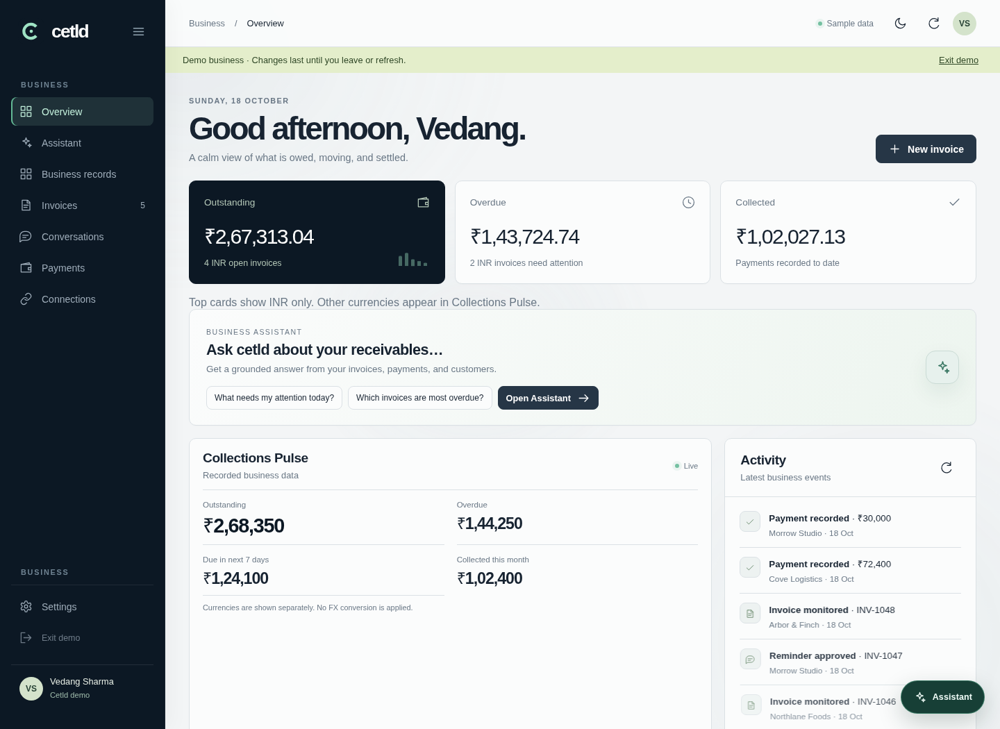
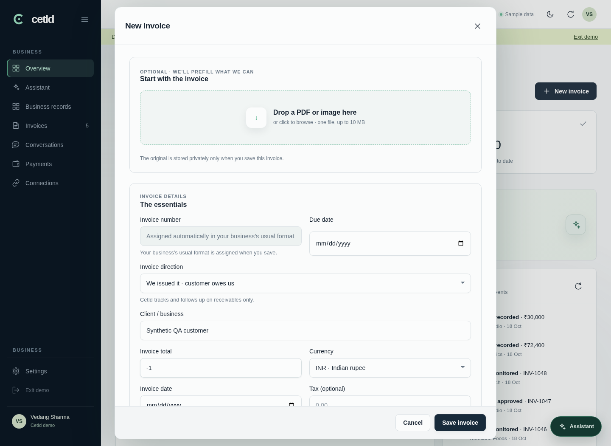
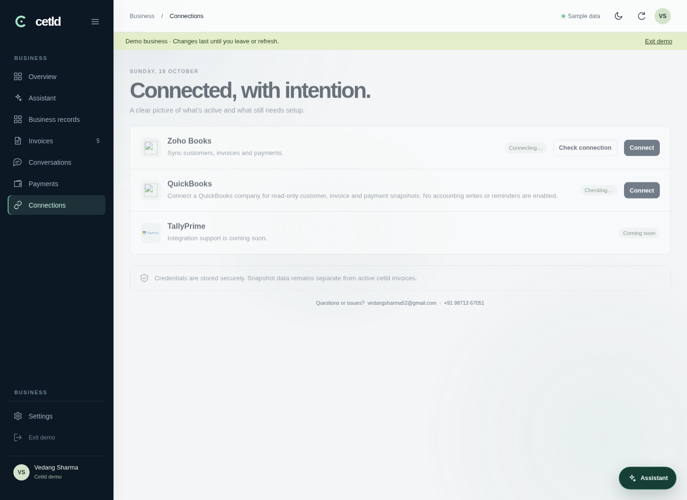
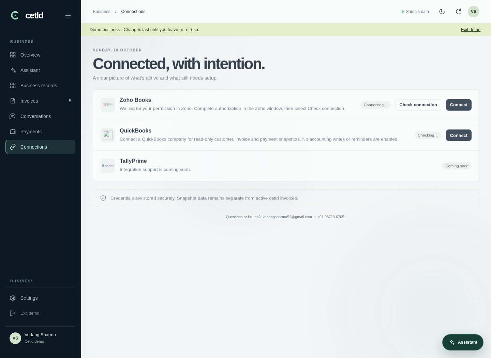

# P6 UX verification

Compared main at `0094fe1` with this branch using Chromium, a fixed timestamp
(2026-10-18 07:00 UTC / 12:30 Asia/Kolkata), and synthetic demo data only.
Supabase was mocked and all other external browser requests were blocked.
The broken pre-change remote logo is shown under these offline conditions.

| View | Before | After |
| --- | --- | --- |
| Dashboard greeting |  |  |
| Negative invoice amount |  |  |
| Zoho authorization pending |  |  |

Browser assertions passed for negative amount copy, local logo loading, pending
Zoho authorization instructions, and a failed settings submission followed by a
successful submission with the stale error hidden. No live records or messages
were accessed or changed.

`node --import tsx --test tests/core.test.mjs tests/accounting.test.mjs tests/accounting-routes.test.mjs tests/zoho-network-retry.test.mjs tests/zoho-organization-diagnostics.test.mjs tests/zoho-ledger-refresh.test.mjs`: 60 passed, 0 failed.

`npm run typecheck`: passed. Fast owner-chat battery: 37 scenarios passed.
